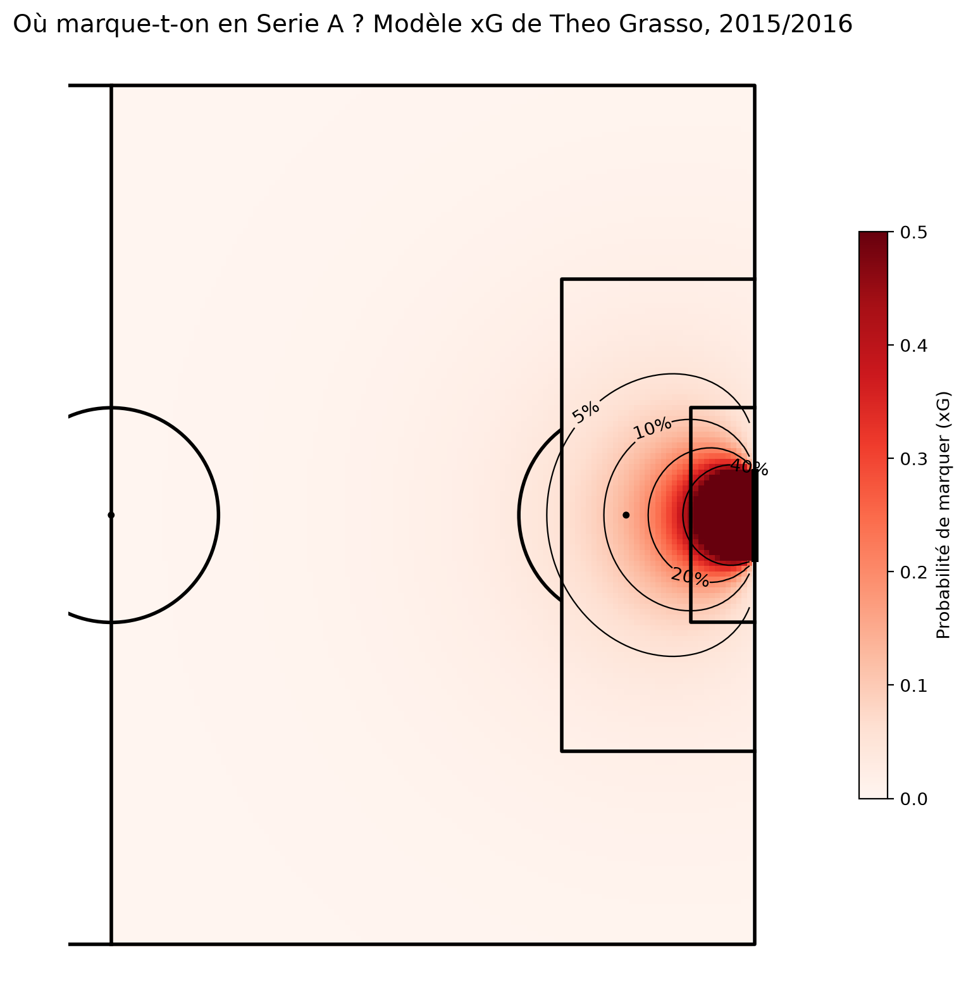
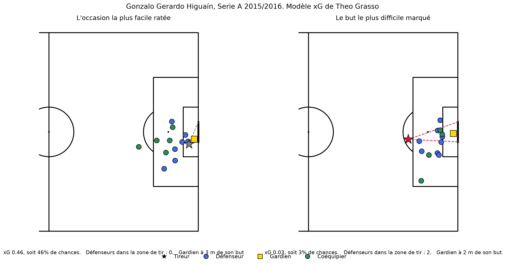
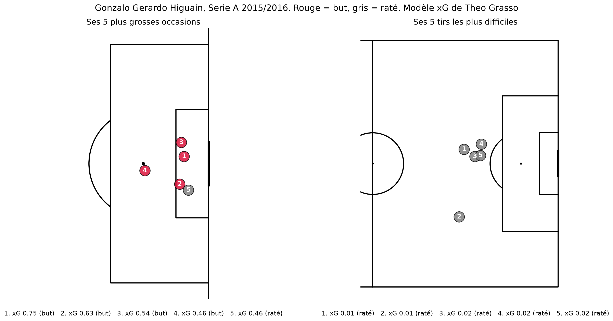
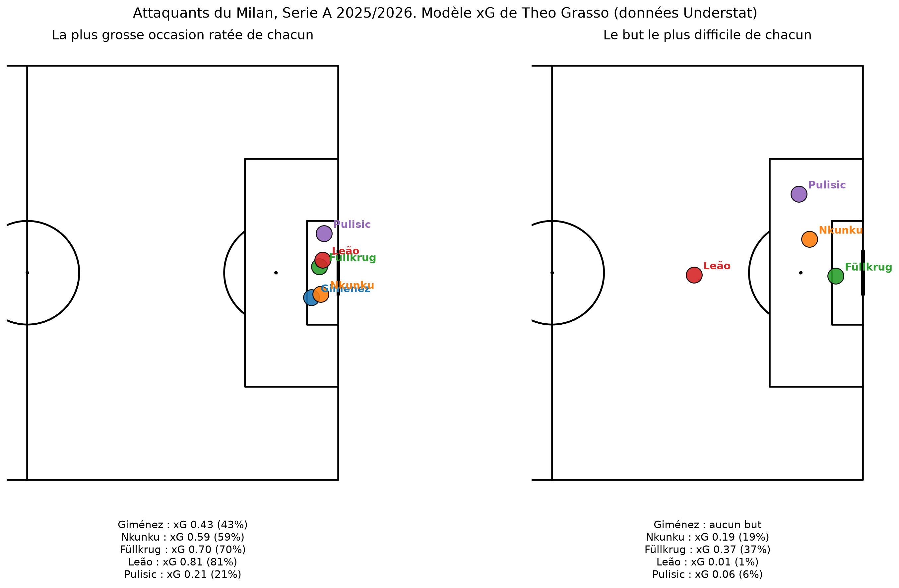

# xG Grasso : un modèle d'expected goals et un calculateur interactif

**👉 Tester l'appli : [29grs92.github.io/xg-grs](https://29grs92.github.io/xg-grs/)**

J'ai construit mon propre modèle d'expected goals (xG) à partir de données brutes, puis je l'ai transformé en appli web gratuite : on place le tireur, les défenseurs et le gardien sur le terrain, on décrit le tir, et l'appli calcule son xG en direct, avec ce qui augmente ou réduit les chances de marquer.

## C'est quoi le xG ?

Le xG mesure la qualité d'une occasion : la probabilité qu'un tir finisse au fond, pour un joueur moyen face à un gardien moyen. Un tir avec un xG de 0,25 finit au fond environ 25 fois sur 100.

## Données

- **Source :** [StatsBomb Open Data](https://github.com/statsbomb/open-data), saison 2015/2016
- **Apprentissage :** 36 508 tirs dans le jeu de la Premier League, de la Liga, de la Serie A, de la Ligue 1 et d'une partie de la Bundesliga (penaltys et coups francs directs exclus)
- **Application au football récent :** tirs du Milan et de la Serie A 2025/2026, données Understat

## Méthode

Pour chaque tir, 18 informations :

| Groupe | Informations |
|---|---|
| Géométrie | Distance au but, angle de tir |
| Tir | Tête, face-à-face, première intention, sous pression |
| Situation de jeu | Contre-attaque, après corner, après coup franc, après touche |
| Dernière passe | Passe en profondeur, cut-back, centre, passe aérienne, sans passe |
| Photo de l'action | Défenseurs dans le triangle de tir, distance du gardien à son but, gardien hors du triangle de tir |

Les informations sur les défenseurs et le gardien viennent des « freeze frames » StatsBomb : je trace un triangle entre le tireur et les deux poteaux, et je compte les adversaires à l'intérieur.

Les modèles sont entraînés sur 75 % des tirs et évalués sur les 25 % qu'ils n'ont jamais vus.

## Résultats

| Modèle | Données d'apprentissage | AUC | Erreur (log loss) | Total xG (883 buts réels) |
|---|---|---|---|---|
| Régression logistique v3 | Serie A seule | 0,808 | 0,256 | 877,5 |
| Régression logistique v3 | 5 grands championnats | 0,808 | 0,255 | 880,3 |
| **Régression logistique v4 (+ dernière passe)** | **5 grands championnats** | **0,808** | **0,254** | **882,0** |
| Gradient boosting | 5 grands championnats | 0,814 | 0,252 | 881,3 |
| xG officiel StatsBomb | | 0,828 | 0,246 | 853,6 |

**Modèle retenu : régression logistique v4.** Le gradient boosting est un peu plus précis, mais chaque résultat d'une régression logistique peut s'expliquer à un staff. Un chiffre qu'on sait expliquer vaut plus qu'un chiffre un peu plus précis qu'on ne sait pas justifier.

## Ce qu'on retient

- **Chaque défenseur dans le triangle de tir** réduit les chances de marquer de 30 à 40 % environ.
- **Une passe en profondeur** double environ les chances de marquer.
- **Une tête** a environ deux fois moins de chances qu'un tir du pied.
- **Plus de données n'a pas amélioré la régression logistique** : un modèle simple atteint vite sa limite. Le gradient boosting ne l'a dépassée qu'avec environ 27 000 tirs d'apprentissage.
- **Sur la Serie A 2015/2016, le modèle prévoit 823,8 buts pour 824 réels**, et ses classements de joueurs collent à ceux de StatsBomb (Higuaín et Salah au-dessus de leur xG, Džeko en dessous).
- **Appliqué à la Serie A 2025/2026 (données Understat)**, le modèle prévoit presque exactement les 46 buts du Milan (45,2 xG). Le xG d'Understat dépasse les buts réels de 14 à 21 % sur les deux dernières saisons, sur les mêmes tirs.

## Visuels

| Carte de xG de la moitié de terrain | Plus grosse occasion ratée et but le plus difficile |
|---|---|
|  |  |

| 5 plus grosses occasions et tirs les plus difficiles | Attaquants du Milan, 2025/2026 |
|---|---|
|  |  |

## Contenu du dépôt

| Fichier | Contenu |
|---|---|
| `index.html` | Le calculateur xG interactif (un seul fichier, fonctionne sans internet) |
| `modele_xg_theo_grasso.ipynb` | Le notebook complet : récupération des données, préparation, modèles, évaluation, visuels |
| `*.png` | Les visuels produits par le notebook |

Pour lancer le notebook : installer Python avec Anaconda, puis `pip install statsbombpy mplsoccer soccerdata`. Le premier lancement télécharge les données StatsBomb (environ une heure pour les cinq championnats).

## Limites

- Une seule saison d'apprentissage, et seulement 34 matchs de Bundesliga disponibles gratuitement.
- Positions de tir moins précises chez Understat, et pas de photo de l'action ni de type de passe sur les données récentes.
- Sur une saison, la chance pèse beaucoup dans l'écart entre buts et xG, surtout pour les joueurs qui tirent peu.

## Auteur

**Theo Grasso**, Data Analyst Football
[LinkedIn](https://www.linkedin.com/in/theo-grasso) · [GitHub](https://github.com/29GRS92)

© 2026 Theo Grasso. Tous droits réservés. Données de tirs : StatsBomb Open Data.
